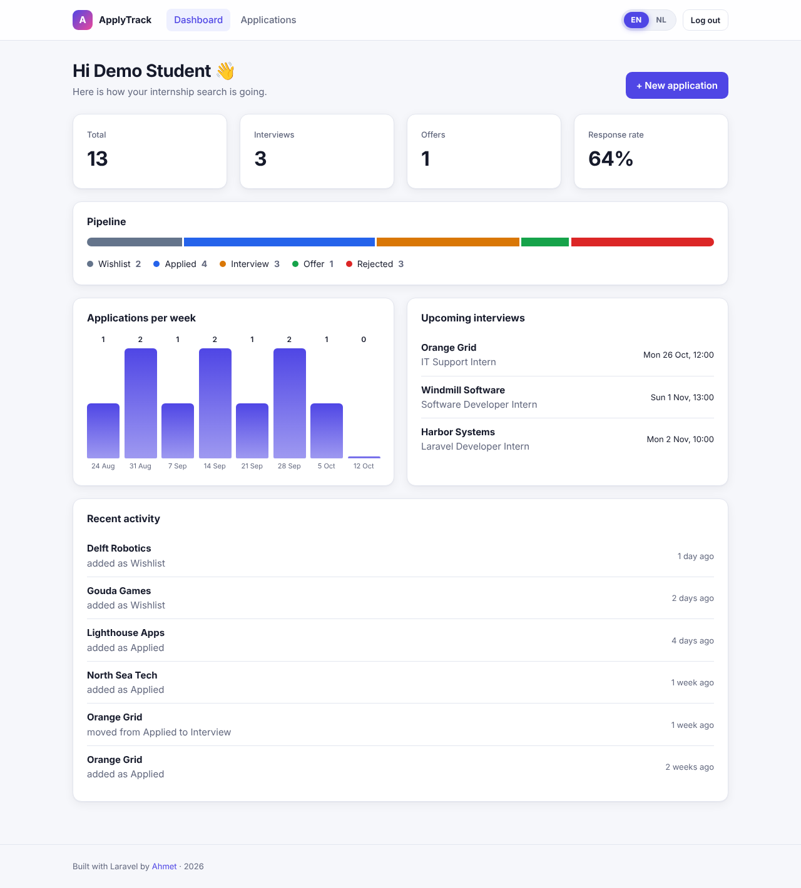
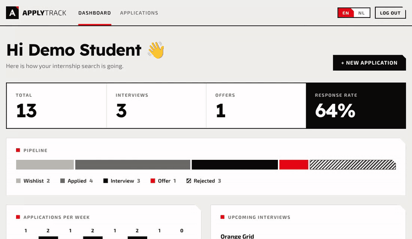
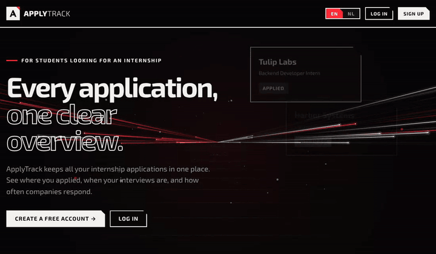
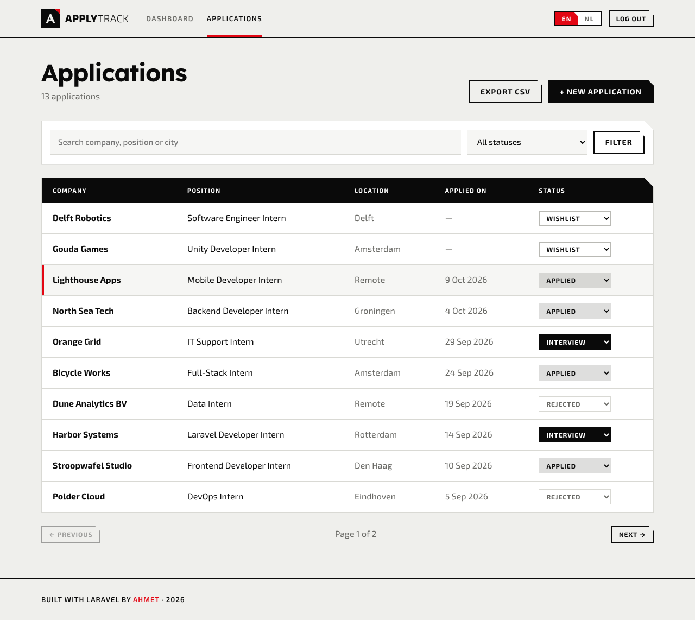
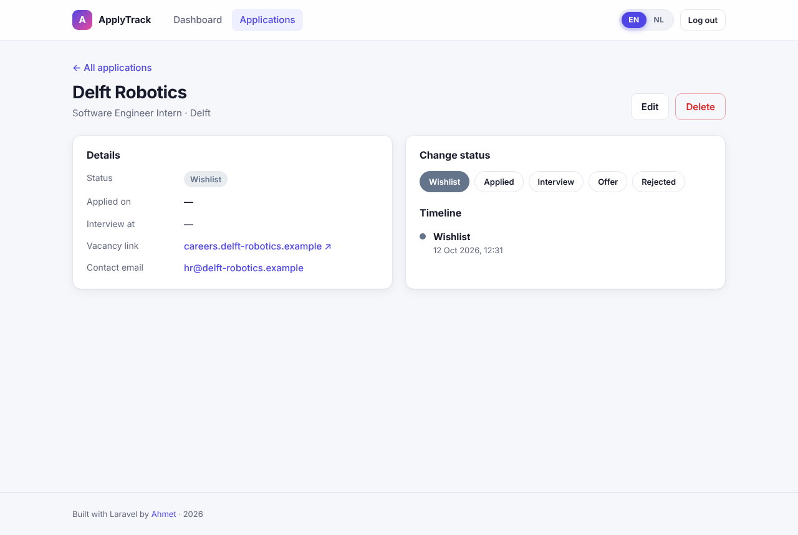
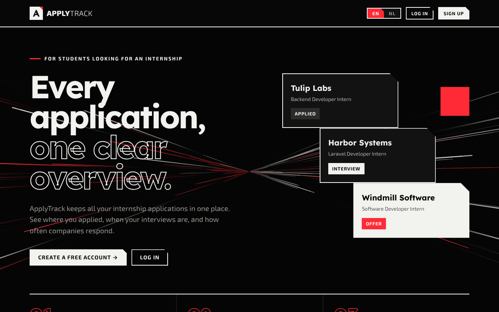
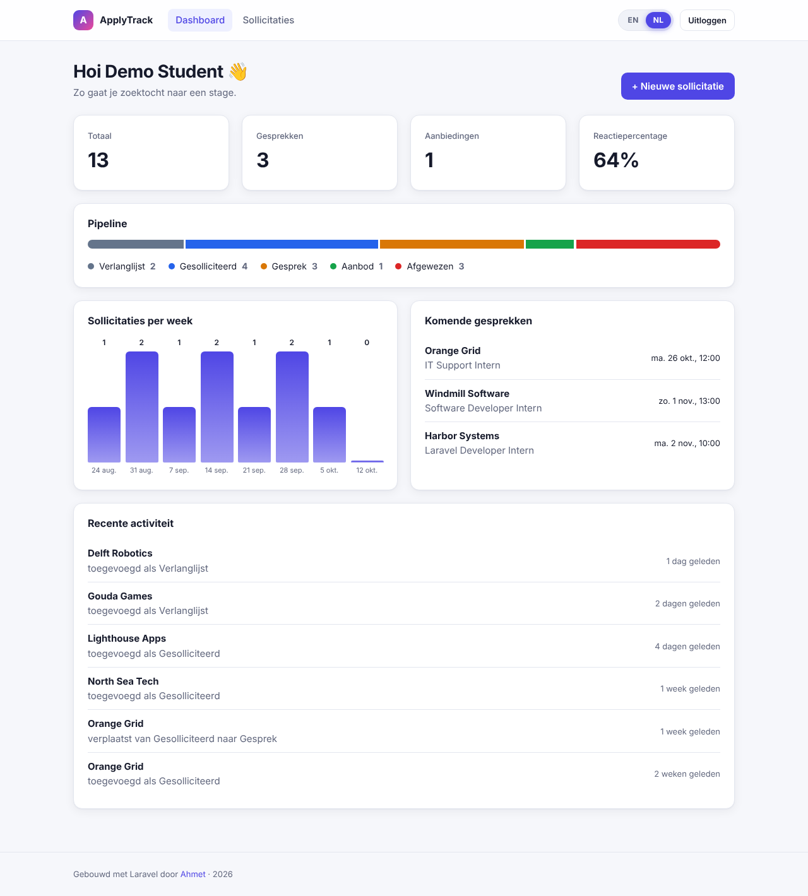
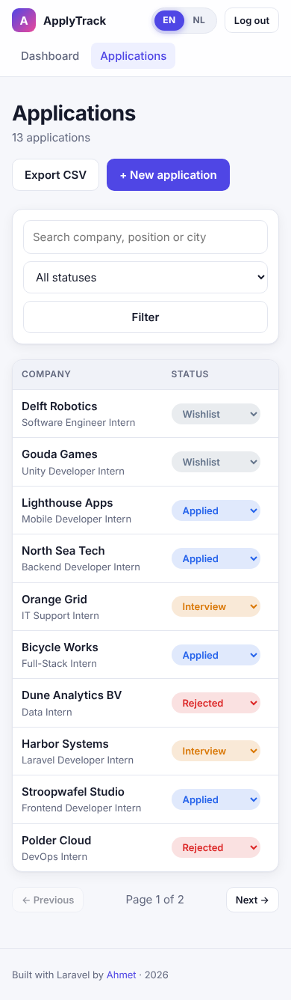

# ApplyTrack

[](https://github.com/AhmetR42/applytrack/actions/workflows/ci.yml)


**ApplyTrack is a web app for students who are looking for an internship.** It keeps every application in one place, moves each one through a clear status pipeline, and shows how the search is going on a dashboard. The whole interface switches between English and Dutch with an animated toggle.

**Live demo:** [applytrack-5b30.onrender.com](https://applytrack-5b30.onrender.com/) (free hosting, so the first visit can take about a minute to wake up; log in with `demo@applytrack.test` / `password`)



## Features

- **Accounts**: register, log in and log out, with login rate limiting and session protection.
- **Applications**: create, edit and delete applications with company, position, location, vacancy link, contact, dates and notes.
- **Status pipeline**: Wishlist → Applied → Interview → Offer / Rejected. Change the status from the list, the detail page or the form.
- **Timeline**: every status change is stored, so each application shows its full history.
- **Dashboard**: totals, response rate, a pipeline bar, applications per week and upcoming interviews.
- **Search, filter and sort** the application list, with pagination.
- **CSV export** of all your applications.
- **English / Dutch** interface with an animated language toggle. A test makes sure no Dutch translation is missing.
- **Authorization**: users can only see and change their own applications (Laravel policies).
- **Dark mode** with an animated "light rails" background on canvas: slow light pulses, drifting dust, a rolling perspective floor, the odd comet, and a vanishing point that follows the mouse. It pauses in background tabs and respects reduced motion, a responsive layout and support for reduced motion.





## Tech stack

| Layer | Tools |
| --- | --- |
| Backend | PHP 8.3, Laravel 13, Eloquent, form requests, policies, enums |
| Database | SQLite (works with MySQL too) |
| Frontend | Blade templates, plain CSS (custom properties, no framework), vanilla JavaScript |
| Testing | PHPUnit feature and unit tests (23 tests) |
| Tooling | Docker, GitHub Actions CI, Laravel Pint |

## Getting started

### Option 1: Docker

```bash
git clone https://github.com/AhmetR42/applytrack.git
cd applytrack
docker compose up --build
```

Open http://localhost:8000 and log in with the demo account:

- Email: `demo@applytrack.test`
- Password: `password`

### Option 2: Online (free)

[](https://render.com/deploy?repo=https://github.com/AhmetR42/applytrack)

The repository contains a `render.yaml`, so Render builds the Docker image and gives the app a public address. Log in with the demo account above. On the free plan the app sleeps after a while without visitors (the first visit then takes about a minute) and the database is reset to the demo data after every restart.

### Option 3: Local PHP

You need PHP 8.3+ and Composer.

```bash
git clone https://github.com/AhmetR42/applytrack.git
cd applytrack
composer setup     # installs dependencies, creates .env and the database, adds demo data
composer dev       # starts the app on http://localhost:8000
```

## Running the tests

```bash
php artisan test
vendor/bin/pint --test   # code style
```

The same checks run on every push in GitHub Actions, together with a Docker build and a smoke test of the container.

## Project structure

```
app/
├── Enums/ApplicationStatus.php        # the five pipeline statuses
├── Http/Controllers/                  # auth, dashboard, applications, export, locale
├── Http/Middleware/SetLocale.php      # applies the chosen language from the session
├── Http/Requests/JobApplicationRequest.php
├── Models/JobApplication.php          # records status changes in model events
└── Policies/JobApplicationPolicy.php  # users can only access their own data
lang/nl.json                           # Dutch translations
public/css/app.css, public/js/app.js   # styles, language toggle animation
resources/views/                       # Blade templates
tests/                                 # feature and unit tests
```

## How the language toggle works

The toggle is a small form with an `EN` and `NL` button. Without JavaScript it simply submits and the server stores the choice in the session. With JavaScript the thumb slides to the other side, the page fades out, the form is submitted, and the new page fades in. All text goes through Laravel's `__()` helper, and `lang/nl.json` holds the Dutch version. Dates are translated too, because Carbon follows the app locale.

## Screenshots

| Applications | Detail and timeline |
| --- | --- |
|  |  |

| Dark mode | Dutch | Mobile |
| --- | --- | --- |
|  |  |  |

## Ideas for later

- Reminders by email before an interview
- Drag-and-drop board view per status
- Upload CV and cover letter per application

## License

MIT. See [LICENSE](LICENSE).
